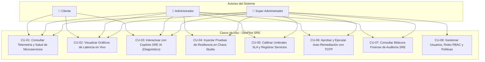

# ESPECIFICACIÓN DE REQUISITOS DE SOFTWARE (SRS)
## Formato Estándar IEEE 830-1998

---

# DevPilot: Sistema de Agente Inteligente para Monitoreo y Auto-Remediación de Microservicios

### Ficha Técnica del Proyecto y Control de Versiones

| Parámetro | Detalle |
| :--- | :--- |
| **Proyecto** | DevPilot — Autonomous Observability, Chaos Testing & AI Remediation Engine |
| **Fecha de Emisión** | 26 de Agosto de 2026 (Revisión Final: 01 de Septiembre de 2026) |
| **Versión del Documento** | Versión 2.0 — Final Corregida y Aumentada (Cumplimiento IEEE 830) |
| **Autores (Estudiantes)** | Sebastian Andres Lopez Garcia & Maria Jose Duarte Ospina |
| **Docente Revisor** | Carlos Alfonso Pineda |
| **Institución** | Facultad de Ingeniería de Sistemas / Computación |
| **Estado de Aprobación** | Documento Válido y Verificado por las partes |

```
           ____________________________               ____________________________
           Sebastian Andres Lopez Garcia               Maria Jose Duarte Ospina
               Líder Técnico & Dev                      Diseño UI/UX & QA Tester

                                  ____________________________
                                      Carlos Alfonso Pineda
                                         Docente Titular
```

---

## TABLA DE CONTENIDO

- [1. INTRODUCCIÓN](#1-introducción)
  - [1.1 Propósito](#11-propósito)
  - [1.2 Ámbito del Sistema (Alcance)](#12-ámbito-del-sistema-alcance)
  - [1.3 Personal Involucrado y Responsabilidades](#13-personal-involucrado-y-responsabilidades)
  - [1.4 Definiciones, Acrónimos y Abreviaturas](#14-definiciones-acrónimos-y-abreviaturas)
  - [1.5 Referencias Normativas y Técnicas](#15-referencias-normativas-y-técnicas)
  - [1.6 Resumen y Estructura del Documento](#16-resumen-y-estructura-del-documento)
- [2. DESCRIPCIÓN GENERAL](#2-descripción-general)
  - [2.1 Perspectiva del Producto](#21-perspectiva-del-producto)
  - [2.2 Funcionalidad General del Producto](#22-funcionalidad-general-del-producto)
  - [2.3 Características de los Usuarios](#23-características-de-los-usuarios)
    - [2.3.1 Matriz de Actores del Sistema](#231-matriz-de-actores-del-sistema)
    - [2.3.2 Historias de Usuario Principales](#232-historias-de-usuario-principales)
  - [2.4 Restricciones Generales](#24-restricciones-generales)
  - [2.5 Suposiciones y Dependencias](#25-suposiciones-y-dependencias)
  - [2.6 Evolución Previsible del Sistema](#26-evolución-previsible-del-sistema)
- [3. REQUISITOS ESPECÍFICOS (IEEE 830)](#3-requisitos-específicos-ieee-830)
  - [3.1 Requisitos de Interfaces Externas](#31-requisitos-de-interfaces-externas)
    - [3.1.1 Interfaces de Usuario (Dashboard SPA Reactivo)](#311-interfaces-de-usuario-dashboard-spa-reactivo)
    - [3.1.2 Interfaces de Hardware](#312-interfaces-de-hardware)
    - [3.1.3 Interfaces de Software](#313-interfaces-de-software)
    - [3.1.4 Interfaces de Comunicación](#314-interfaces-de-comunicación)
  - [3.2 Arquitectura de Software y Patrón Modelo-Vista-VistaModelo (MVVM)](#32-arquitectura-de-software-y-patrón-modelo-vista-vistamodelo-mvvm)
    - [3.2.1 Justificación Técnica del Patrón MVVM](#321-justificación-técnica-del-patrón-mvvm)
    - [3.2.2 Desglose de Componentes MVVM en DevPilot](#322-desglose-de-componentes-mvvm-en-devpilot)
    - [3.2.3 Diagrama de Flujo y Data Binding Reactivo](#323-diagrama-de-flujo-y-data-binding-reactivo)
  - [3.3 Requisitos de Seguridad: Autenticación y Autorización](#33-requisitos-de-seguridad-autenticación-y-autorización)
    - [3.3.1 Sistema de Autenticación: Justificación e Implementación (SSO + TOTP Step-Up)](#331-sistema-de-autenticación-justificación-e-implementación-sso--totp-step-up)
    - [3.3.2 Sistema de Autorización: OAuth 2.0 + JWT y Matriz RBAC](#332-sistema-de-autorización-oauth-20--jwt-y-matriz-rbac)
    - [3.3.3 Ciclo de Vida de Tokens y Protección de Endpoints](#333-ciclo-de-vida-de-tokens-y-protección-de-endpoints)
  - [3.4 Requisitos Funcionales (RF)](#34-requisitos-funcionales-rf)
    - [RF01: Monitoreo Continuo y Sondeo de Salud](#rf01-monitoreo-continuo-y-sondeo-de-salud)
    - [RF02: Detección Automática de Anomalías e Incidentes](#rf02-detección-automática-de-anomalías-e-incidentes)
    - [RF03: Diagnóstico Causal Asistido por Inteligencia Artificial](#rf03-diagnóstico-causal-asistido-por-inteligencia-artificial)
    - [RF04: Auto-Remediación Human-in-the-Loop](#rf04-auto-remediación-human-in-the-loop)
    - [RF05: Inyección Controlada de Fallos (Chaos Studio)](#rf05-inyección-controlada-de-fallos-chaos-studio)
    - [RF06: Calibración Dinámica de Umbrales de Alerta](#rf06-calibración-dinámica-de-umbrales-de-alerta)
    - [RF07: Autenticación Unificada SSO y Doble Factor OTP](#rf07-autenticación-unificada-sso-y-doble-factor-otp)
    - [RF08: Control de Acceso Basado en Roles (RBAC) con JWT](#rf08-control-de-acceso-basado-en-roles-rbac-con-jwt)
    - [RF09: Reactividad de Telemetría bajo Patrón MVVM](#rf09-reactividad-de-telemetría-bajo-patrón-mvvm)
    - [RF10: Pista de Auditoría Forense y Trazabilidad](#rf10-pista-de-auditoría-forense-y-trazabilidad)
  - [3.5 Requisitos No Funcionales (RNF)](#35-requisitos-no-funcionales-rnf)
    - [3.5.1 Rendimiento](#351-rendimiento)
    - [3.5.2 Seguridad Operacional](#352-seguridad-operacional)
    - [3.5.3 Fiabilidad y Disponibilidad](#353-fiabilidad-y-disponibilidad)
    - [3.5.4 Usabilidad y Experiencia de Usuario](#354-usabilidad-y-experiencia-de-usuario)
    - [3.5.5 Portabilidad y Mantenibilidad](#355-portabilidad-y-mantenibilidad)
- [4. MATRIZ DE TRAZABILIDAD Y VERIFICACIÓN](#4-matriz-de-trazabilidad-y-verificación)

---

# 1. INTRODUCCIÓN

Las arquitecturas contemporáneas de software se fundamentan preponderantemente en microservicios, donde una multitud de servicios pequeños, desacoplados y altamente especializados colaboran para brindar capacidades de negocio. Si bien este paradigma confiere alta escalabilidad y despliegues independientes, incrementa exponencialmente la complejidad operacional, la superficie de fallas distribuidas y el esfuerzo de telemetría necesario para su supervisión. Para equipos de ingeniería reducidos o pequeñas y medianas empresas (PyMEs) con restricciones de personal y presupuesto, la detección temprana, diagnóstico y resolución de incidentes en topologías de microservicios suele transformarse en un cuello de botella crítico que degrada el Acuerdo de Nivel de Servicio (SLA).

En este escenario surge **DevPilot**, una plataforma de ingeniería de fiabilidad del sitio (SRE), observabilidad proactiva y auto-remediación asistida por Inteligencia Artificial. En lugar de exigir a los ingenieros la inspección manual de múltiples fuentes de logs y métricas dispersas bajo situaciones de estrés, DevPilot centraliza el monitoreo de salud, detecta anomalías en tiempo real mediante umbrales estocásticos y heurísticos, infiere la causa raíz mediante un agente cognitivo conectado a Modelos de Lenguaje de Gran Escala (LLM) con capacidad de ejecución de herramientas (*tool use*), y facilita la remediación de incidentes mediante orquestación de contenedores bajo un esquema estricto de confirmación humana (*Human-in-the-Loop*).

### 1.1 Propósito
El propósito del presente documento es especificar formalmente, conforme a los lineamientos normativos del estándar **IEEE 830-1998**, los requisitos de software funcionales y no funcionales, las interfaces del sistema, los modelos de seguridad de identidad (Autenticación y Autorización) y el diseño arquitectónico reactivo basado en el patrón **Modelo-Vista-VistaModelo (MVVM)** para la implementación del sistema **DevPilot**. 

Este documento sirve de contrato técnico vinculante entre el equipo de desarrollo, los analistas de calidad, el docente evaluador y los futuros mantenedores de la plataforma.

### 1.2 Ámbito del Sistema (Alcance)
El producto desarrollado comprende una solución integral de software empaquetada mediante contenedores Docker, cuyo alcance incluye:

| Componente de Software | Límites y Alcance Específico |
| :--- | :--- |
| **Microservicios Base de Prueba** | Implementación de tres servicios distribuidos políglotas (`users` en Node.js/Express, `products` en Python/FastAPI y `orders` en Python/FastAPI), interconectados en una red bridge (`devpilot_net`). |
| **Motor de Monitoreo Autónomo** | Hilo demonio de alta eficiencia que ejecuta sondeos de salud (*health-probes*) cada 5 segundos contra las rutas `/health` de los microservicios, cuantificando latencia (RTT) y disponibilidad. |
| **Detección de Anomalías** | Motor de reglas analíticas que dispara incidentes operativos cuando la latencia promedio supera 2.000 ms, la tasa móvil de respuestas 5xx supera el 20%, o existe caída del socket TCP/HTTP. |
| **Inyector de Caos (Chaos Testing)** | Módulo de inyección deliberada de latencia artificial, fallos 500 y detención controlada para validar la observabilidad y resiliencia del clúster. |
| **Agente Inteligente SRE** | Agente conversacional conectado a la API de Anthropic Claude (con fallback heurístico autónomo) capaz de consultar logs en vivo, inspeccionar telemetría y recomendar acciones correctivas en lenguaje natural. |
| **Motor de Auto-Remediación** | Ejecución de reinicios controlados de contenedores (`RESTART_CONTAINER`) y reajuste de estado mediante comunicación directa con el socket de Docker (`/var/run/docker.sock`). |
| **Arquitectura de Interfaz MVVM** | Dashboard Web Single Page Application (SPA) con enlace de datos bidireccional reactivo y separación nítida entre Modelo, Vista y VistaModelo para refresco asíncrono de telemetría sin parpadeo visual. |
| **Capa de Seguridad Integral** | Autenticación basada en **Single Sign-On (SSO / OIDC)** integrada con **TOTP (Time-based One-Time Password / OTP)** para acciones críticas de remediación, acompañada de un sistema de autorización **OAuth 2.0 + JWT** con control de acceso basado en roles (**RBAC**). |
| **Persistencia Transaccional** | Motor de base de datos relacional (SQLite / PostgreSQL) que asegura consistencia ACID en métricas, incidentes, bitácora de remediación y auditoría forense. |

### 1.3 Personal Involucrado y Responsabilidades

| Nombre | Rol Formal | Responsabilidades Principales | Contacto |
| :--- | :--- | :--- | :--- |
| **Sebastian Andres Lopez Garcia** | Líder Técnico, Arquitecto de Software & Desarrollador Backend | • Análisis formal de requisitos y arquitectura distribuida.<br>• Implementación del núcleo backend en Python/FastAPI.<br>• Desarrollo del monitor demonio, Docker Manager y Agente LLM.<br>• Integración del esquema de seguridad OAuth 2.0 / JWT y TOTP.<br>• Despliegue y orquestación con Docker Compose. | `sebastian.lopez@devpilot.io`<br>(+57) 311 719 1920 |
| **Maria Jose Duarte Ospina** | Diseñadora UI/UX, Desarrolladora Frontend & Líder de Calidad (QA) | • Diseño de la experiencia de usuario y prototipado visual.<br>• Maquetación del Dashboard SPA en Tailwind CSS y Dark Mode.<br>• Implementación del patrón reactivo MVVM en el cliente.<br>• Diseño del plan de pruebas funcionales y Chaos Testing.<br>• Validación de accesibilidad, telemetría y documentación IEEE. | `mariajose.duarte@devpilot.io`<br>(+57) 302 417 2827 |
| **Carlos Alfonso Pineda** | Docente Evaluador / Director de Proyecto | • Acompañamiento metodológico y validación de entregables.<br>• Evaluación de la arquitectura, estándares IEEE y rigor técnico. | Docente Titular |

### 1.4 Definiciones, Acrónimos y Abreviaturas

*   **ACID:** Atomicity, Consistency, Isolation, Durability (Atomicidad, Consistencia, Aislamiento y Durabilidad).
*   **API:** Application Programming Interface (Interfaz de Programación de Aplicaciones).
*   **Chaos Engineering:** Disciplina de experimentación sobre un sistema distribuido para crear confianza en su capacidad para resistir condiciones turbulentas en producción.
*   **Data Binding:** Mecanismo de sincronización automática de datos entre la interfaz de usuario (Vista) y la lógica de estado (ViewModel).
*   **Docker SDK:** Biblioteca de desarrollo que permite interactuar programáticamente con el demonio de Docker mediante su socket UNIX local.
*   **Health-Check:** Sondeo periódico automatizado ejecutado para determinar si un microservicio está disponible y en condiciones de procesar solicitudes.
*   **Human-in-the-Loop (HITL):** Modelo de control donde las decisiones generadas por agentes de IA requieren confirmación y autorización explícita de un operador humano antes de surtir efecto destructivo o modificador.
*   **IEEE 830-1998:** Norma internacional estandarizada por el Institute of Electrical and Electronics Engineers para la redacción de Especificaciones de Requisitos de Software.
*   **JWT (JSON Web Token):** Estándar abierto (RFC 7519) que define un formato compacto y autónomo para transmitir información de forma segura entre partes como un objeto JSON firmado criptográficamente.
*   **LLM:** Large Language Model (Modelo de Lenguaje de Gran Escala).
*   **MFA:** Multi-Factor Authentication (Autenticación Multifactor).
*   **MVVM:** Model-View-ViewModel (Modelo-Vista-VistaModelo), patrón de arquitectura de interfaz de usuario enfocado en separación de responsabilidades y reactividad.
*   **OAuth 2.0:** Framework de autorización estándar de la industria (RFC 6749) que permite que aplicaciones obtengan acceso limitado a cuentas de usuario sobre HTTP.
*   **OIDC (OpenID Connect):** Capa de identidad simple sobre el protocolo OAuth 2.0 que permite la autenticación federada (SSO).
*   **OTP / TOTP:** One-Time Password / Time-based One-Time Password (RFC 6238), algoritmo estandarizado para generar contraseñas de un solo uso dependientes del tiempo.
*   **RBAC:** Role-Based Access Control (Control de Acceso Basado en Roles).
*   **RTT:** Round-Trip Time (Tiempo de ida y vuelta de un paquete de red o solicitud HTTP).
*   **SRE:** Site Reliability Engineering (Ingeniería de Fiabilidad de Sitios).
*   **SSO:** Single Sign-On (Inicio de Sesión Único).

### 1.5 Referencias Normativas y Técnicas
1. **IEEE Std 830-1998:** *IEEE Recommended Practice for Software Requirements Specifications*, IEEE Computer Society, 1998.
2. **RFC 7519:** *JSON Web Token (JWT)*, Internet Engineering Task Force (IETF), Mayo 2015.
3. **RFC 6749:** *The OAuth 2.0 Authorization Framework*, IETF, Octubre 2012.
4. **RFC 6238:** *TOTP: Time-Based One-Time Password Algorithm*, IETF, Mayo 2011.
5. **OpenID Connect Core 1.0:** *OpenID Foundation*, Noviembre 2014.
6. **Docker Engine API v1.43+ Documentation:** Docker Inc., 2024.
7. **Anthropic Claude API & Tool Use Specifications:** Anthropic PBC, 2024.
8. **Repositorio Central del Proyecto:** Código fuente, contenedores y scripts en `devpilot/`.

### 1.6 Resumen y Estructura del Documento
El presente documento se estructura en cuatro secciones principales:
*   **Sección 1 (Introducción):** Describe el propósito, alcance, partes interesadas y definiciones formales del proyecto.
*   **Sección 2 (Descripción General):** Presenta la perspectiva sistémica, las funcionalidades primordiales, los roles de usuario con sus historias de usuario, restricciones técnicas reales, suposiciones operativas y proyecciones de evolución.
*   **Sección 3 (Requisitos Específicos):** Detalla exhaustivamente las interfaces externas, la arquitectura del patrón reactivo **MVVM**, el diseño formal de **Autenticación (SSO + TOTP)** y **Autorización (OAuth 2.0 + JWT + RBAC)**, los diez Requisitos Funcionales (RF01–RF10) y los Requisitos No Funcionales (RNF).
*   **Sección 4 (Matriz de Trazabilidad):** Correlaciona los requisitos con sus componentes de implementación y métodos de verificación.

---

# 2. DESCRIPCIÓN GENERAL

### 2.1 Perspectiva del Producto
DevPilot es un sistema de observabilidad y remediación de infraestructura que opera en el mismo plano de red que los microservicios objetivo, pero manteniendo un aislamiento absoluto respecto a su código de negocio interno. No introduce librerías invasivas ni intercepta el tráfico de producción; su acción se fundamenta en un desacoplamiento mediante sondeos externos periódicos (`/health`), lectura de telemetría de contenedores mediante el socket UNIX de Docker (`/var/run/docker.sock`) y llamadas REST estándar.

El sistema se compone de los siguientes subsistemas interconectados:
1.  **DevPilot Core Backend (FastAPI):** Servidor asíncrono de alto rendimiento encargado del hilo demonio de monitoreo, orquestador de base de datos, motor de inyección de caos y pasarela de inferencia del Agente IA.
2.  **Dashboard SPA Reactivo (MVVM):** Interfaz gráfica unificada para visualización de telemetría en tiempo real, consola conversacional de asistencia SRE, disparador de caos y centro de autorización HITL.
3.  **Agente de Razonamiento Claude SRE:** Componente cognitivo integrado mediante llamadas asíncronas con capacidades de *Tool Calling* (consulta de métricas, obtención de logs y propuesta de reinicios).
4.  **Cluster de Microservicios Evaluados:** Contenedores independientes (`users`, `products`, `orders`) con endpoints de salud y puertos expuestos para simulación y pruebas de carga.
5.  **Módulo Criptográfico de Seguridad:** Proveedor de identidad federada (SSO), validador de claims JWT con RBAC y generador/verificador de desafíos TOTP.

```
 +-------------------------------------------------------------------------+
 |                               USUARIO / SRE                             |
 +------------------------------------+------------------------------------+
                                      | (HTTPS / WSS)
                                      v
 +-------------------------------------------------------------------------+
 |                       DASHBOARD SPA REACTIVO (MVVM)                     |
 |  [ Vista: HTML5 + Tailwind CSS ] <---> [ ViewModel: Estado & Comandos ]  |
 +------------------------------------+------------------------------------+
                                      | (JWT + OAuth 2.0 Bearer)
                                      v
 +-------------------------------------------------------------------------+
 |                     DEVPILOT CORE (FastAPI :8000)                       |
 |  +--------------------+  +--------------------+  +--------------------+ |
 |  | Auth SSO & TOTP    |  | RBAC Guard & JWT   |  | Chaos Studio Engine| |
 |  +--------------------+  +--------------------+  +--------------------+ |
 |  +--------------------+  +--------------------+  +--------------------+ |
 |  | Monitor Daemon (5s)|  | SQLite / Postgres  |  | Docker Manager     | |
 |  +--------------------+  +--------------------+  +--------------------+ |
 +---------+--------------------------+-----------------------+------------+
           |                          |                       |
           | (/health cada 5s)        | (Claude Messages API) | (docker.sock)
           v                          v                       v
 +--------------------+    +--------------------+    +--------------------+
 |   MICROSERVICIOS   |    |    ANTHROPIC API   |    |   DOCKER ENGINE    |
 | users  (:3001)     |    | Claude 3.5 Sonnet  |    | (Contenedores      |
 | products (:3002)   |    | con Tool Use       |    |  Lifecycle & Logs) |
 | orders (:3003)     |    |                    |    |                    |
 +--------------------+    +--------------------+    +--------------------+
```

### 2.2 Funcionalidad General del Producto
DevPilot ofrece el siguiente conjunto de capacidades integradas:
*   **Sondeo No Invasivo de Disponibilidad:** Ejecución de peticiones HTTP GET cada 5 segundos contra las rutas de diagnóstico de los servicios.
*   **Recolección Continua de Telemetría:** Captura y almacenamiento en series temporales del tiempo de respuesta (RTT en milisegundos), estado HTTP y consumo de recursos.
*   **Detección Automatizada de Incidentes:** Evaluación paramétrica continua que cataloga fallos bajo criterios de *Latencia Crítica* (> 2.000 ms), *Tasa de Errores Elevada* (> 20% de respuestas 5xx) o *Caída Total* (Status 503 / Timeout).
*   **Diagnóstico Contextual Asistido por IA:** Análisis de incidentes mediante el agente Claude SRE, correlacionando telemetría previa y logs del contenedor para explicar la causa raíz en lenguaje claro.
*   **Auto-Remediación con Validación Humana:** Sugerencia de planes de mitigación (reinicio de contenedores o restablecimiento de estado) con botones de aprobación protegidos por doble factor TOTP.
*   **Laboratorio de Caos (Chaos Studio):** Inyección manual controlada de latencia artificial, fallos internos 500 y detención simulada de microservicios.
*   **Control de Identidad y Acceso:** Autenticación federada SSO con doble factor TOTP y autorización de endpoints por roles (RBAC) validada en cada petición mediante tokens JWT.
*   **Reactividad en Tiempo Real:** Renderizado desacoplado mediante patrón MVVM en la interfaz web, garantizando actualización inmediata de gráficos y tarjetas sin recarga completa de página.

### 2.3 Características de los Usuarios y Casos de Uso

#### 2.3.1 Diagrama General de Casos de Uso (UML)

El modelo de casos de uso del sistema DevPilot define tres actores humanos primarios con jerarquía y segregación estricta de funciones (**Cliente**, **Administrador**, **Super Administrador**) y un actor no humano de soporte (**Agente IA / Sistema**):



#### 2.3.2 Matriz de Actores del Sistema y Segregación de Roles

| Actor / Rol | Nivel Técnico | Responsabilidades y Actividades en el Sistema | Permisos RBAC Asignados |
| :--- | :--- | :--- | :--- |
| **Cliente** | Básico / No Técnico | Usuario final o stakeholder que consulta el estado general de los microservicios, dashboards consolidados y disponibilidad de la infraestructura sin privilegios operativos. | `Cliente` (`metrics:read`). Solo lectura de telemetría y métricas. |
| **Administrador** | Intermedio a Avanzado | Ingeniero SRE / DevOps encargado de la operación continua. Ejecuta pruebas de caos para verificar resiliencia, calibra umbrales SLA de latencia y error, interactúa con el asistente IA y aprueba planes de remediación de contenedores mediante validación Step-Up TOTP. | `Administrador` (`metrics:read`, `logs:read`, `ai:chat`, `chaos:inject`, `remediation:execute`, `thresholds:write`, `audit:read`). |
| **Super Administrador** | Avanzado | Máxima autoridad del clúster y de la organización. Administra usuarios y asignación de roles, inspecciona la bitácora inmutable de auditoría forense, gobierna políticas globales de remediación y tiene acceso irrestricto a todos los comandos del sistema. | `Super_Administrador` (Acceso total: `metrics:read`, `logs:read`, `ai:chat`, `chaos:inject`, `remediation:execute`, `thresholds:write`, `audit:read`, `users:manage`, `system:config`). |
| **Agente de IA (Actor No Humano)** | Automatizado | Sistema de inferencia cognitivo (Claude 3.5 / Heurístico local) que analiza anomalías, redacta explicaciones causales y estructura propuestas de solución para validación humana. | `System_Agent` (Emisión de diagnósticos e inferencia asistida). |

#### 2.3.3 Historias de Usuario Principales

*   **HU-01 (Detección Oportuna):** *Como Administrador*, quiero que el sistema detecte proactivamente degradaciones de latencia y fallos 5xx antes de que impacten a los usuarios finales, para reducir el Tiempo Medio de Detección (MTTD).
*   **HU-02 (Diagnóstico Asistido):** *Como Administrador*, quiero preguntarle al agente de IA qué causó la degradación de un servicio en lenguaje natural, para no tener que revisar manualmente miles de líneas de logs.
*   **HU-03 (Remediación Segura Human-in-the-Loop):** *Como Administrador o Super Administrador*, quiero aprobar o rechazar explícitamente cualquier orden de reinicio de contenedor sugerida por la IA mediante un token TOTP, para evitar que una decisión autónoma errónea afecte la producción.
*   **HU-04 (Autenticación Federada SSO):** *Como Cliente, Administrador o Super Administrador*, quiero ingresar a la plataforma usando mis credenciales corporativas (SSO vía OIDC/OAuth 2.0), para autenticarme de manera segura y unificada.
*   **HU-05 (Pruebas de Resiliencia):** *Como Administrador*, quiero inyectar latencia controlada o errores 500 desde una interfaz visual (Chaos Studio), para validar que los mecanismos de alerta y remediación respondan correctamente.
*   **HU-06 (Auditoría Forense y Gobernanza):** *Como Super Administrador*, quiero consultar una bitácora inmutable de todas las remediaciones e inyecciones de caos efectuadas con identificación del operador, método de autenticación y marca de tiempo, para cumplir con normativas de seguridad.
*   **HU-07 (Visualización de Estado):** *Como Cliente*, quiero observar en tiempo real si los servicios de Usuarios, Productos y Órdenes están saludables o degradados sin riesgo de alterar la configuración operativa.

### 2.4 Restricciones Generales

*   **Restricciones de Arquitectura y Runtime:** El núcleo de backend debe construirse en **Python 3.11+** haciendo uso del framework **FastAPI**, apoyado en el servidor asíncrono **Uvicorn**, con el fin de soportar operaciones concurrentes sin bloqueo de hilos.
*   **Contenerización Obligatoria:** Todo el ecosistema (DevPilot Core y los tres microservicios políglotas `users`, `products`, `orders`) debe empaquetarse y orquestarse mediante **Docker Engine** y **Docker Compose v2+**, sobre una red virtual tipo bridge denominada `devpilot_net`.
*   **Acceso al Socket de Docker:** El contenedor `devpilot_core` requiere el montaje del volumen `/var/run/docker.sock` con permisos controlados de lectura y ejecución para permitir la extracción de logs y el comando de reinicio de contenedores.
*   **Persistencia Relacional ACID:** Los datos operacionales (servicios, telemetría, incidentes, bitácora de auditoría y sesiones) deben persistirse en un motor relacional con soporte transaccional ACID (**SQLite** para entornos de laboratorio/pruebas o **PostgreSQL** para producción).
*   **Restricciones de Interfaz de Usuario:** El cliente debe operar como una **Single Page Application (SPA)** responsiva construida con estándares modernos (HTML5 semántico, **Tailwind CSS** para estilizado utilitario y Dark Mode, **Lucide Icons** y **Chart.js** para visualización de telemetría), implementando estrictamente el patrón arquitectural **Modelo-Vista-VistaModelo (MVVM)** para reactividad sin parpadeo.
*   **Restricciones Criptográficas de Seguridad:** Los tokens de acceso deben cumplir estrictamente el estándar **JSON Web Token (JWT - RFC 7519)** firmados mediante algoritmos criptográficos robustos (**RS256** con par de claves asimétricas o **HS256** con clave simétrica secreta de al menos 256 bits). Las contraseñas y secretos TOTP deben procesarse mediante **Argon2id** o **PBKDF2**.
*   **Dependencia Externa con Degradación Elegante:** El sistema depende del acceso a la API externa de **Anthropic Claude** (o proveedores LLM compatibles como Gemini/OpenAI). En caso de desconexión o agotamiento de cuota, el sistema está obligado a degradar a un **modo heurístico autónomo local** sin suspender el monitoreo ni la capacidad de remediación humana.

### 2.5 Suposiciones y Dependencias
*   **Disponibilidad del Demonio de Docker:** Se asume que el host de despliegue cuenta con el servicio de Docker activo y accesible a través del socket UNIX estándar.
*   **Conectividad a Internet:** Se asume disponibilidad de red externa con protocolo HTTPS (puerto 443) para la comunicación con los proveedores de SSO (Google/GitHub OIDC) y la API de inferencia de IA.
*   **Contratos de Salud de Microservicios:** Se asume que todo microservicio que aspire a ser monitoreado expone obligatoriamente un endpoint HTTP accesible en la ruta `/health`, que devuelva un código HTTP 200 en estado nominal.

### 2.6 Evolución Previsible del Sistema
En versiones subsiguientes, el sistema DevPilot prevé expandir su alcance hacia:
1.  **Soporte Multi-Orquestador:** Extensión del agente de auto-remediación para interactuar con clústeres de **Kubernetes (K8s)** mediante la API de Kubernetes, permitiendo reinicio de Pods, escalado horizontal (HPA) y balanceo dinámico.
2.  **Canales de Notificación Proactiva:** Integración nativa de Webhooks con plataformas de comunicación colaborativa como **Slack, Discord y Microsoft Teams**, notificando incidentes y permitiendo la aprobación de remediación mediante botones interactivos seguros.
3.  **Modelos de Aprendizaje Predictivo:** Incorporación de modelos locales de series temporales (e.g., Prophet, ARIMA o LSTM) para predecir saturación de memoria o disco antes de que ocurra la anomalía.
4.  **Arquitectura Multi-Tenant (SaaS):** Adaptación del esquema de base de datos y autorización para admitir múltiples organizaciones independientes con aislamiento total de métricas y roles.

---

# 3. REQUISITOS ESPECÍFICOS (IEEE 830)

## 3.1 Requisitos de Interfaces Externas

### 3.1.1 Interfaces de Usuario (Dashboard SPA Reactivo)
La interfaz de usuario de DevPilot se diseña bajo premisas de ingeniería SRE moderna, ergonomía visual y accesibilidad técnica:
*   **Barra de Estado Global (Top Navigation):** Presenta el estado de salud del clúster (Healthy, Degraded, Critical), reloj de sincronización en tiempo real, latencia media agregada y selector de usuario con visualización de rol activo y botón de cierre de sesión SSO.
*   **Panel de Monitoreo de Microservicios (Service Grid):** Tarjetas dinámicas individuales para cada servicio (`users`, `products`, `orders`), reflejando su estado operativo con código de color estandarizado, latencia instantánea, tasa de éxito y botones de acción rápida (ver logs, probar health).
*   **Gráfica de Telemetría Dinámica:** Gráfico de líneas temporales multitraza impulsado por Chart.js, que visualiza la evolución del RTT de los servicios en una ventana deslizante de tiempo.
*   **Laboratorio de Fallos (Chaos Studio):** Matriz de control interactiva para inyectar fallos controlados (demora artificial en ms, inyección de fallos 500 o crash de contenedor) y botón de restauración total (`RESET_FAULT_STATE`).
*   **Consola de Asistencia SRE (Chat IA):** Ventana de conversación interactiva con burbujas de diálogo estructuradas, visualización de código Markdown y tarjetas emergentes de auto-remediación con botones de confirmación ("Aprobar Remedio" / "Descartar").
*   **Modales de Detalle Operacional:** Ventanas modales para inspección en vivo de logs de contenedores (`stdout` / `stderr`), auditoría histórica de remediaciones y registro de nuevos microservicios.

### 3.1.2 Interfaces de Hardware
DevPilot opera sobre hardware de propósito general sin requerimientos especializados:
*   **Servidor / Estación de Trabajo:** Procesador con arquitectura x86_64 o ARM64 (mínimo 2 núcleos físicos, recomendado 4 núcleos o superior). Memoria RAM mínima de 4 GB (recomendado 8 GB para ejecución holgada de contenedores y buffer de base de datos). Espacio en disco de al menos 10 GB para almacenamiento de imágenes Docker, base de datos de telemetría y logs.
*   **Dispositivos de Interacción del Operador:** Monitor con resolución estándar mínima de 1280x720 píxeles (optimizado para 1920x1080 o superior), teclado estándar y dispositivo apuntador (mouse) o pantalla táctil compatible.

### 3.1.3 Interfaces de Software
*   **Docker Engine & Docker Compose (v20.10+ / Compose v2.0+):** Interfaz para el aprovisionamiento, red virtual bridge y control del ciclo de vida de los contenedores.
*   **Docker UNIX Socket (`/var/run/docker.sock`):** Protocolo de comunicación bidireccional mediante el cual el backend consulta estadísticas en vivo de CPU/RAM, lee flujos de logs y ejecuta las llamadas `container.restart()`.
*   **Anthropic Claude Messages API (v1):** Protocolo de inferencia externa basado en HTTPS REST para el envío de prompts estructurados, historial de telemetría y definición de herramientas (`tools`) para diagnóstico causal.
*   **Motor de Base de Datos SQLite 3 / PostgreSQL 14+:** Driver de conexión relacional mediante SQLAlchemy y SQLite/asyncpg para persistencia estructurada.

### 3.1.4 Interfaces de Comunicación
*   **Protocolo HTTP/1.1 y HTTP/2 sobre TCP/IP:** Utilizado para los sondeos continuos de salud hacia los microservicios y para la comunicación entre el cliente web y el backend en el puerto `8000`.
*   **Tokens de Comunicación Segura:** Encabezados HTTP `Authorization: Bearer <JWT>` transmitidos en cada petición REST hacia la API de DevPilot Core.
*   **Red Aislada de Docker (`devpilot_net`):** Red interna puente con resolución DNS automática por nombre de contenedor (`http://users_service:3001`, `http://products_service:3002`, `http://orders_service:3003`).

---

## 3.2 Arquitectura de Software y Patrón Modelo-Vista-VistaModelo (MVVM)

### 3.2.1 Justificación Técnica del Patrón MVVM
DevPilot es un sistema de observabilidad **altamente reactivo**: recibe telemetría cada 5 segundos, actualiza gráficos de series temporales de latencia, refresca el estado operativo de múltiples contenedores de forma concurrente, recibe respuestas de diagnósticos de IA y gestiona peticiones de remediación. 

El acoplamiento directo entre la interfaz gráfica (DOM) y la lógica de negocio o llamadas de red generaría efectos adversos como parpadeo visual (*flickering*), fugas de memoria por listeners huérfanos, inconsistencia de estado ante peticiones concurrentes y dificultad absoluta para realizar pruebas unitarias sobre la lógica de presentación.

Para resolver este desafío de ingeniería, se adopta formalmente el patrón **Modelo-Vista-VistaModelo (MVVM)**, desacoplando completamente la capa de presentación de la capa de datos mediante un enlace de datos reactivo (*Reactive Data Binding*) y un contenedor de estado observable.

### 3.2.2 Desglose de Componentes MVVM en DevPilot

```
+---------------------------------------------------------------------------------+
|                                CAPA VISTA (VIEW)                                |
|  • Estructura declarativa HTML5 y clases utilitarias Tailwind CSS               |
|  • Contenedor de gráficos Canvas (Chart.js) y elementos de icono (Lucide)       |
|  • Captura eventos de usuario (clicks en Chaos, inputs de Chat, botones Modal)  |
|  • Enlazada bidireccionalmente a las propiedades del ViewModel (DOM Listeners)  |
+---------------------------------------^-----------------------------------------+
                                        | (Notificaciones de cambio / Observables)
                                        | (Comandos / Event Dispatchers)
+---------------------------------------v-----------------------------------------+
|                          CAPA VISTA-MODELO (VIEWMODEL)                          |
|  • Estado Observable Reactivo (State Store):                                    |
|      - `servicesList`: Array observable de servicios y métricas                 |
|      - `telemetryHistory`: Buffer circular de métricas para Chart.js            |
|      - `activeIncidents`: Lista reactiva de anomalías abiertas                  |
|      - `chatConversation`: Historial de mensajes y estado de carga (typing)     |
|      - `authState`: Información de usuario activo, token JWT y permisos RBAC    |
|  • Propiedades Computadas:                                                      |
|      - `globalClusterStatus`: Derivado automático ('HEALTHY'|'DEGRADED'|'CRIT') |
|      - `averageClusterLatency`: Cálculo reactivo de RTT medio                   |
|      - `isRemediationAllowed`: Validación instantánea de rol y 2FA              |
|  • Comandos Ejecutables (Command Pattern):                                      |
|      - `PollTelemetryCommand()`                                                 |
|      - `InjectChaosCommand(service, type, params)`                              |
|      - `SubmitAIPromptCommand(message)`                                         |
|      - `ApproveRemediationCommand(incidentId, totpToken)`                       |
+---------------------------------------^-----------------------------------------+
                                        | (Operaciones asíncronas REST / Data Access)
                                        | (Mapeo de Entidades DTO)
+---------------------------------------v-----------------------------------------+
|                               CAPA MODELO (MODEL)                               |
|  • Entidades de Dominio (Data Structures & DTOs):                               |
|      - `ServiceRecord`: id, name, url, current_status, latency_ms               |
|      - `IncidentRecord`: id, service, severity, description, status             |
|      - `RemediationProposal`: action, container_id, confidence, rationale       |
|  • Clientes de Red y Persistencia Local:                                        |
|      - `ApiClient`: Wrapper asíncrono con inyección de JWT e interceptores HTTP |
|      - `StorageRepository`: Gestión de sesión en sessionStorage/localStorage    |
|      - `DataTransformers`: Normalización de payloads JSON del backend           |
+---------------------------------------------------------------------------------+
```

#### Estructura de Directorios del Patrón MVVM en DevPilot
A nivel de implementación física de código, la arquitectura MVVM se segrega estrictamente por carpetas bajo `devpilot_core/static/`:
*   **Carpeta Modelo (`devpilot_core/static/models/`)**: `apiClient.js`, `authModel.js`, `telemetryModel.js`, `chaosModel.js`, `remediationModel.js`, `servicesModel.js`, `logsModel.js`, `chatModel.js`, `model.js`.
*   **Carpeta Controlador / Vista-Modelo (`devpilot_core/static/controllers/`)**: `appController.js`, `controller.js`.
*   **Carpeta Vista (`devpilot_core/static/views/`)**: `view.js`.
*   **Puentes y Bootstrap (`devpilot_core/static/js/`)**: `eventBridges.js`, `app.js`.

### 3.2.3 Diagrama de Flujo y Data Binding Reactivo
1.  **Ciclo de Telemetría:** El `ViewModel` ejecuta periódicamente el comando `PollTelemetryCommand`.
2.  **Extracción del Modelo:** El `ApiClient` (Modelo) realiza un `fetch('/api/dashboard/stats')` con credenciales Bearer JWT.
3.  **Actualización del Estado Reactivo:** El Modelo transforma el payload JSON y actualiza las propiedades del `State Store` del ViewModel.
4.  **Disparo de Observadores hacia la Vista:** La actualización del estado emite una notificación reactiva. La Vista, sin recargar el DOM completo, actualiza únicamente los elementos diferenciales (el badge de color de cada servicio, los puntos de la curva de Chart.js y la lista de incidentes).
5.  **Flujo de Comandos de Remediación:** Cuando el usuario presiona "Aprobar Remedio" en la Vista, se invoca `ApproveRemediationCommand`, el cual solicita el token TOTP, valida permisos con el estado de autorización local del ViewModel y despacha la petición autenticada al backend.

---

## 3.3 Requisitos de Seguridad: Autenticación y Autorización

### 3.3.1 Sistema de Autenticación: Justificación e Implementación (SSO + TOTP Step-Up)

#### Justificación Técnica Comparativa: OTP vs SSO
Para una plataforma moderna de ingeniería de software y observabilidad operativa como DevPilot, se analizó exhaustivamente la conveniencia técnica entre **OTP (One-Time Password)** y **SSO (Single Sign-On)**:

| Criterio de Evaluación | Enfoque A: Solo OTP / Contraseña Local | Enfoque B: SSO Federado (OIDC) | Enfoque Seleccionado: SSO con TOTP Step-Up |
| :--- | :--- | :--- | :--- |
| **Experiencia de Usuario** | Requiere creación manual de cuentas, memorizar contraseñas o depender de correos/SMS lentos para ingresar. | Inicio de sesión en un solo clic aprovechando la identidad corporativa (GitHub/Google/Keycloak). | **Óptima:** Acceso ágil vía SSO para el trabajo diario, sin fricción de contraseñas. |
| **Seguridad Organizacional** | Riesgo de reutilización de contraseñas débiles o retención de accesos tras la salida de un ingeniero. | Desaprovisionamiento centralizado: si un empleado deja la empresa, su acceso a DevPilot se revoca instantáneamente. | **Máxima:** Centralización de identidad en el IdP corporativo + protección criptográfica local. |
| **Protección ante Acciones Destructivas** | Débil si la sesión queda abierta en un terminal desatendido. | Débil si una sesión SSO activa es aprovechada por un tercero para reiniciar contenedores. | **Invulnerable:** Requiere un desafío **TOTP (Time-based OTP)** en tiempo real antes de ejecutar cualquier acción crítica (*Step-up Authentication*). |

#### Decisión de Arquitectura:
Se implementa una arquitectura híbrida de máxima seguridad:
1.  **Mecanismo de Autenticación Primaria: SSO Federado basado en OpenID Connect (OIDC) / OAuth 2.0.** Permite el inicio de sesión único mediante proveedores de identidad ampliamente utilizados por desarrolladores (como GitHub OAuth o Google Workspace). El usuario se autentica contra el IdP, el cual emite un `id_token` y un código de autorización intercambiable por credenciales de DevPilot.
2.  **Mecanismo de Autenticación Secundaria / Refuerzo: Doble Factor TOTP (RFC 6238).** Para acciones de alto impacto operacional (reiniciar contenedores mediante el Docker SDK o inyectar fallos de caos en producción), el sistema exige **Autenticación Escalonada (Step-Up Authentication)** mediante la introducción de un código numérico temporal de 6 dígitos generado por aplicaciones compatibles (Google Authenticator, Microsoft Authenticator o 1Password).

### 3.3.2 Sistema de Autorización: OAuth 2.0 + JWT y Matriz RBAC

#### Justificación Técnica: HTTP Basic vs OAuth 2.0 / JWT
Se descartan mecanismos obsoletos como HTTP Basic Authentication por su incapacidad para codificar roles sin consultar la base de datos en cada petición, y su dependencia de envío de credenciales en cada encabezado.

Se implementa el estándar **OAuth 2.0** en combinación con **JSON Web Tokens (JWT - RFC 7519)** con esquema de control de acceso basado en roles (**RBAC**):
*   **Tokens Stateless (Sin Estado):** El JWT contiene claims criptográficamente firmados que incluyen el identificador del usuario (`sub`), nombre (`name`), rol asignado (`role`), lista de permisos técnicos (`scopes`) y tiempo de expiración (`exp`).
*   **Rendimiento en Sondeos Frecuentes:** Dado que el Dashboard reactivo sondea métricas cada 5 segundos, un esquema con sesiones de base de datos saturaría el I/O. El token JWT permite que el middleware de FastAPI valide criptográficamente la firma del token en memoria en menos de **0.5 milisegundos**, sin realizar consultas a la base de datos.
*   **Rotación Segura:** Implementación de pares de tokens: un *Access Token* de corta duración (15 a 30 minutos) y un *Refresh Token* opaco de larga duración (7 días) almacenado con flags `HttpOnly` y `SameSite=Strict`.

#### Matriz de Roles y Permisos (RBAC)

| Permiso Operacional (Scope) | Descripción Técnica | Admin | SRE_Operator | Developer | Viewer |
| :--- | :--- | :---: | :---: | :---: | :---: |
| `metrics:read` | Lectura de estado de salud, métricas de CPU/RAM y gráficos. | Sí | Sí | Sí | Sí |
| `logs:read` | Consulta y visualización de logs de contenedores en tiempo real. | Sí | Sí | Sí | No |
| `ai:chat` | Envío de prompts diagnósticos al Agente Claude SRE. | Sí | Sí | Sí | No |
| `chaos:inject` | Inyección de latencia y fallos controlados en microservicios. | Sí | No | Sí | No |
| `remediation:execute` | Aprobación de reinicios y auto-remediación (requiere TOTP). | Sí | Sí | No | No |
| `thresholds:write` | Calibración de umbrales SLA de latencia y tasas de fallo. | Sí | No | No | No |
| `audit:read` | Visualización de bitácoras de auditoría de incidentes y remediación. | Sí | Sí | Sí | No |
| `users:manage` | Asignación de roles, revocación de tokens y parámetros de seguridad. | Sí | No | No | No |

### 3.3.3 Ciclo de Vida de Tokens y Protección de Endpoints

```
  [ Cliente Web (SPA) ]               [ DevPilot Core (API) ]            [ Proveedor SSO (IdP) ]
           |                                     |                                   |
           | 1. Iniciar Sesión SSO               |                                   |
           |------------------------------------------------------------------------>|
           | 2. Autenticación exitosa y redirección con Authorization Code           |
           |<------------------------------------------------------------------------|
           |                                     |                                   |
           | 3. Intercambio de Código            |                                   |
           |------------------------------------>|                                   |
           |                                     | 4. Validación de Code con IdP     |
           |                                     |---------------------------------->|
           |                                     | 5. Confirmación de Identidad      |
           |                                     |<----------------------------------|
           |                                     | 6. Generación JWT (Claims + Role) |
           | 7. Entrega Access Token JWT         |                                   |
           |<------------------------------------|                                   |
           |                                     |                                   |
           | 8. Petición GET /api/dashboard/stats [Authorization: Bearer <JWT>]       |
           |------------------------------------>|                                   |
           |                                     | 9. Validación criptográfica local |
           | 10. Datos de Telemetría (200 OK)    |                                   |
           |<------------------------------------|                                   |
           |                                     |                                   |
           | 11. POST /api/remediation/apply {action: RESTART, totp: "492810"}       |
           |------------------------------------>|                                   |
           |                                     | 12. Valida Rol (RBAC) + TOTP      |
           |                                     | 13. Docker SDK: container.restart |
           | 14. Confirmación de Remediación     |                                   |
           |<------------------------------------|                                   |
```

---

## 3.4 Requisitos Funcionales (RF)

### RF01: Monitoreo Continuo y Sondeo de Salud
*   **Identificador:** `RF01`
*   **Nombre:** Monitoreo Continuo de Microservicios.
*   **Descripción:** El sistema debe ejecutar un proceso en segundo plano que sondee periódicamente (intervalo predeterminado de 5 segundos) la disponibilidad de las rutas `/health` de todos los microservicios activos en el clúster.
*   **Actores:** Sistema (Monitor Autónomo Daemon).
*   **Entradas:** Respuestas HTTP (Código de estado, cuerpo JSON de salud y marca de tiempo).
*   **Procesamiento:** Medición precisa del tiempo de ida y vuelta (RTT) en milisegundos; categorización de estado (Healthy, Degraded, Down); inserción transaccional de métricas en la base de datos relacional.
*   **Salidas:** Registro persistido en la tabla de métricas y emisión de estado hacia el ViewModel.
*   **Requisitos Relacionados:** `RF02`, `RNF-R1`, `RNF-F3`.
*   **Prioridad:** Alta (Esencial).

### RF02: Detección Automática de Anomalías e Incidentes
*   **Identificador:** `RF02`
*   **Nombre:** Detección Automática de Anomalías e Incidentes.
*   **Descripción:** El sistema debe evaluar automáticamente los datos de telemetría de cada ciclo de monitoreo contra umbrales preestablecidos (latencia RTT > 2.000 ms, tasa móvil de errores 5xx > 20% o indisponibilidad total) y abrir formalmente un incidente operativo.
*   **Actores:** Sistema (Motor de Reglas de SLA).
*   **Entradas:** Métrica consolidada del último sondeo y ventana deslizante de muestras previas.
*   **Procesamiento:** Comparación booleana contra umbrales configurados; si se detecta trasgresión y no existe un incidente abierto para dicho servicio, se crea un registro de incidente con estado `OPEN` y nivel de severidad correspondiente. Si el servicio retorna a parámetros nominales, el sistema debe marcar el incidente como `RESOLVED` automáticamente.
*   **Salidas:** Notificación reactiva de nuevo incidente en el Dashboard y registro en base de datos.
*   **Requisitos Relacionados:** `RF01`, `RF06`, `RNF-R1`.
*   **Prioridad:** Alta (Esencial).

### RF03: Diagnóstico Causal Asistido por Inteligencia Artificial
*   **Identificador:** `RF03`
*   **Nombre:** Diagnóstico Causal Asistido por Inteligencia Artificial.
*   **Descripción:** El sistema debe permitir al operador interactuar mediante una consola de chat en lenguaje natural para solicitar un diagnóstico de causa raíz sobre anomalías detectadas en cualquier microservicio.
*   **Actores:** Usuario (`SRE_Operator`, `Developer`, `Admin`), Agente Claude SRE.
*   **Entradas:** Consulta en texto del operador, identificador del incidente o servicio, buffer de telemetría reciente y últimas 50 líneas de logs del contenedor.
*   **Procesamiento:** Estructuración de prompt contextualizado con herramientas de SRE (*tool calling*); invocación a la API de Anthropic Claude; en caso de indisponibilidad externa, activación automática del motor analítico heurístico local.
*   **Salidas:** Respuesta diagnóstica estructurada en lenguaje natural, identificando la anomalía, el componente afectado, el grado de confianza y la propuesta formal de solución.
*   **Requisitos Relacionados:** `RF02`, `RF04`, `RNF-R3`, `RNF-F1`.
*   **Prioridad:** Alta (Esencial).

### RF04: Auto-Remediación Human-in-the-Loop
*   **Identificador:** `RF04`
*   **Nombre:** Auto-Remediación con Confirmación Humana y Verificación TOTP.
*   **Descripción:** El sistema debe proveer una interfaz para aplicar acciones correctivas recomendadas por la IA (tales como reinicio del contenedor afectado o reset de fallos de caos). Ninguna acción modificadora o destructiva podrá ejecutarse sin la aprobación explícita de un operador autenticado mediante token TOTP.
*   **Actores:** Usuario autorizado (`SRE_Operator`, `Admin`), Docker SDK.
*   **Entradas:** Identificador de la propuesta de remediación, autorización del usuario y código TOTP de 6 dígitos.
*   **Procesamiento:** Validación del token TOTP y permisos RBAC; llamada a la función `docker_manager.restart_service()` vía Docker Engine API; verificación del restablecimiento del servicio tras el reinicio; registro de auditoría.
*   **Salidas:** Contenedor reiniciado en el clúster, cambio de estado de la propuesta a `EXECUTED` y entrada en la bitácora forense de auditoría.
*   **Requisitos Relacionados:** `RF03`, `RF07`, `RF08`, `RNF-S3`.
*   **Prioridad:** Alta (Esencial).

### RF05: Inyección Controlada de Fallos (Chaos Studio)
*   **Identificador:** `RF05`
*   **Nombre:** Simulación e Inyección de Fallos (Chaos Studio).
*   **Descripción:** El sistema debe incluir un laboratorio de pruebas de caos que permita inducir intencionalmente anomalías controladas sobre microservicios específicos para validar la capacidad reactiva del monitor y del agente de IA.
*   **Actores:** Usuario (`Developer`, `Admin`).
*   **Entradas:** Selección del microservicio destino y tipo de fallo: Latencia artificial (ms), Inyección de errores 500 (probabilidad en porcentaje), Caída de proceso (Crash) o Restablecimiento integral (`Reset`).
*   **Procesamiento:** Envío de comandos autenticados hacia los endpoints `/fault/*` del microservicio respectivo y confirmación de recepción.
*   **Salidas:** Modificación del comportamiento del microservicio e inicio inmediato del ciclo de detección de incidentes en el monitor.
*   **Requisitos Relacionados:** `RF01`, `RF02`, `RF08`.
*   **Prioridad:** Media (Relevante).

### RF06: Calibración Dinámica de Umbrales de Alerta
*   **Identificador:** `RF06`
*   **Nombre:** Calibración Dinámica de Umbrales de SLA.
*   **Descripción:** El sistema debe proveer un mecanismo que permita a los administradores calibrar en tiempo real los límites de latencia tolerable (ms) y porcentaje admisible de fallos HTTP 5xx para cada microservicio independiente.
*   **Actores:** Administrador (`Admin`).
*   **Entradas:** Identificador del servicio, valor umbral de latencia máxima y porcentaje de error tolerable.
*   **Procesamiento:** Validación de consistencia de tipos y persistencia de las nuevas reglas en la base de datos operacional sin requerir reinicio del monitor.
*   **Salidas:** Actualización en caliente de las variables de detección del hilo monitor.
*   **Requisitos Relacionados:** `RF02`, `RF08`.
*   **Prioridad:** Media (Relevante).

### RF07: Autenticación por Credenciales, SSO y Doble Factor TOTP
*   **Identificador:** `RF07`
*   **Nombre:** Autenticación por Usuario/Contraseña, SSO e Identidad Multifactor TOTP.
*   **Descripción:** El sistema debe autenticar a los usuarios mediante credenciales directas (nombre de usuario o correo corporativo y contraseña con cifrado SHA-256) o integración federada SSO (OIDC/OAuth 2.0). Asimismo, debe exigir un código de autenticación de un solo uso basado en tiempo (TOTP - RFC 6238) para operaciones críticas de remediación.
    *   **Credenciales del Sistema:**
        *   `superadmin` / `SuperAdmin2026*` $\rightarrow$ Rol `Super_Administrador`
        *   `admin` / `AdminPass2026*` $\rightarrow$ Rol `Administrador`
        *   `cliente` / `Cliente2026*` $\rightarrow$ Rol `Cliente`
*   **Actores:** Todos los Usuarios del Sistema (`Cliente`, `Administrador`, `Super Administrador`).
*   **Entradas:** Nombre de usuario/correo y contraseña en el formulario de inicio de sesión; código TOTP de 6 dígitos introducido durante operaciones sensibles.
*   **Procesamiento:** Validación criptográfica de contraseña mediante función hash con salt; mapeo del perfil en la base de datos relacional; emisión de token JWT firmado con algoritmo HMAC-SHA256 (RFC 7519); validación de clave TOTP según algoritmo HMAC-SHA1 con ventana de deriva de 30 segundos.
*   **Salidas:** Emisión de token de acceso JWT firmado y establecimiento de sesión autenticada.
*   **Requisitos Relacionados:** `RF08`, `RNF-S2`, `RNF-S4`.
*   **Prioridad:** Alta (Esencial).

### RF08: Control de Acceso Basado en Roles (RBAC) con JWT
*   **Identificador:** `RF08`
*   **Nombre:** Control de Acceso Basado en Roles (RBAC) con Verificación Criptográfica de JWT.
*   **Descripción:** El sistema debe restringir el acceso a cada endpoint de la API REST y a cada componente visual de la SPA en estricta concordancia con el rol asignado (`Cliente`, `Administrador`, `Super_Administrador`):
    *   **👑 `Super_Administrador` (Sebastian Lopez - 12 Permisos):** Gobernanza total de la infraestructura y seguridad. Incluye:
        *   `metrics:read`: Monitoreo y telemetría en tiempo real de todos los microservicios.
        *   `incidents:read` y `incidents:manage`: Visualización, resolución y cierre manual de incidentes.
        *   `logs:read`: Inspección forense y lectura de logs internos de Docker.
        *   `ai:chat`: Asistencia y diagnóstico inteligente con Claude SRE.
        *   `chaos:inject`: Inyección de fallos de resiliencia en Chaos Studio.
        *   `remediation:execute`: Autorización Human-in-the-Loop y ejecución de auto-remediaciones con TOTP.
        *   `thresholds:write`: Calibración en caliente de umbrales SLA de latencia y porcentaje de error.
        *   `services:manage`: Registro y desregistro de microservicios en el clúster.
        *   `audit:read`: Consulta inmutable de la pista de auditoría forense.
        *   `users:manage`: Gobernanza de operadores, cuentas y roles del sistema.
        *   `system:config`: Políticas globales de seguridad criptográfica y clúster.
    *   **🛠️ `Administrador` (Maria Jose Duarte - 10 Permisos):** Operación técnica SRE y estabilidad de microservicios:
        *   Incluye: `metrics:read`, `incidents:read`, `incidents:manage`, `logs:read`, `ai:chat`, `chaos:inject`, `remediation:execute` (con Step-Up TOTP), `thresholds:write`, `services:manage` y `audit:read`.
        *   Restricciones: Sin acceso a gobernanza de usuarios (`users:manage`) ni configuración raíz (`system:config`).
    *   **👁️ `Cliente` (Carlos Pineda - 3 Permisos):** Consulta de Disponibilidad y Seguimiento de SLAs:
        *   Incluye: `metrics:read` (visualización de salud y latencias), `incidents:read` (seguimiento de incidentes para validar SLAs) y `ai:chat` (consultas al asistente sobre el estado de la plataforma).
        *   Restricciones: Sin acceso a inyección de fallos, sin auto-remediación/reinicios, sin modificación de umbrales, sin logs crudos ni auditoría de seguridad.
*   **Actores:** Sistema (Middleware de Seguridad FastAPI), Usuarios Autenticados.
*   **Entradas:** Encabezado HTTP `Authorization: Bearer <token_jwt>` en cada petición.
*   **Procesamiento:** Decodificación y validación de firma criptográfica del JWT (RFC 7519 HS256); verificación del tiempo de expiración (`exp`); contrastación de los permisos del token contra los requeridos por el recurso. Si no cumple, retornar código HTTP 403 Forbidden.
*   **Salidas:** Acceso concedido al recurso solicitado o denegación inmediata con respuesta JSON estandarizada y alerta visual en el frontend.
*   **Requisitos Relacionados:** `RF04`, `RF05`, `RF06`, `RF07`.
*   **Prioridad:** Alta (Esencial).

### RF09: Reactividad de Telemetría bajo Patrón MVVM
*   **Identificador:** `RF09`
*   **Nombre:** Sincronización Reactiva de Telemetría en la Interfaz (MVVM).
*   **Descripción:** El sistema debe actualizar fluidamente la vista del Dashboard SPA en cada ciclo de sondeo, reflejando cambios de estado, curvas de latencia en la gráfica y contadores de incidentes sin recargar la página web ni generar parpadeo en el navegador.
*   **Actores:** Usuario, ViewModel de la Interfaz Web.
*   **Entradas:** Flujo asíncrono de datos de telemetría provisto por la API del backend.
*   **Procesamiento:** El Modelo almacena y estructura los datos; el ViewModel actualiza el estado observable y computa los indicadores agregados; el mecanismo de Data Binding actualiza exclusivamente los nodos DOM alterados.
*   **Salidas:** Interfaz de usuario actualizada de forma atómica y fluida a 60 FPS.
*   **Requisitos Relacionados:** `RF01`, `RNF-R2`, `RNF-U2`.
*   **Prioridad:** Media (Relevante).

### RF10: Pista de Auditoría Forense y Trazabilidad
*   **Identificador:** `RF10`
*   **Nombre:** Registro Inmutable de Auditoría de Operaciones.
*   **Descripción:** El sistema debe registrar de manera persistente e inmutable cada acción relevante ejecutada sobre la plataforma, incluyendo inyecciones de caos, autorizaciones de auto-remediación, reinicios de contenedores y alteraciones de umbrales.
*   **Actores:** Sistema (Módulo de Auditoría), Usuarios Operadores.
*   **Entradas:** Identificador de usuario, rol, IP de origen, tipo de acción, entidad destino, resultado de la operación y marca de tiempo ISO 8601.
*   **Procesamiento:** Inserción transaccional de registro en la tabla de auditoría con integridad referencial.
*   **Salidas:** Registro de auditoría consultable desde el modal de auditoría por usuarios con permisos `audit:read`.
*   **Requisitos Relacionados:** `RF04`, `RF05`, `RF08`.
*   **Prioridad:** Media (Relevante).

---

## 3.5 Requisitos No Funcionales (RNF)

### 3.5.1 Rendimiento

| Identificador | Requisito | Métrica Cuantitativa | Prioridad |
| :--- | :--- | :--- | :--- |
| **RNF-R1** | **Tiempo de Detección de Fallas (MTTD)** | El motor de monitoreo debe detectar una caída o degradación anómala en un tiempo inferior a **5 segundos** tras su ocurrencia. | Alta |
| **RNF-R2** | **Tiempo de Carga Inicial del Dashboard** | La SPA debe cargar completamente la interfaz, fuentes y primera telemetría en menos de **2.0 segundos** sobre una conexión de banda ancha estándar. | Alta |
| **RNF-R3** | **Latencia de Inferencia del Agente IA** | El diagnóstico generado por Claude debe formularse y desplegarse en pantalla en menos de **4.0 segundos** (o menos de **1.0 segundo** en modo heurístico local). | Alta |
| **RNF-R4** | **Sobrecarga de Red del Monitor** | El tráfico generado por los health-checks hacia cada microservicio no debe exceder los **2 KB/s**, garantizando nulo impacto en el ancho de banda del negocio. | Media |

### 3.5.2 Seguridad Operacional

| Identificador | Requisito | Criterio de Aceptación | Prioridad |
| :--- | :--- | :--- | :--- |
| **RNF-S1** | **Aislamiento de Red de Microservicios** | Toda la comunicación inter-servicio y el acceso a `/health` debe ocurrir estrictamente dentro de la red virtual de Docker (`devpilot_net`), sin exponer puertos no requeridos a internet. | Alta |
| **RNF-S2** | **Protección de Secretos y API Keys** | Ninguna clave criptográfica (API Key de Anthropic, secretos de firma JWT o credenciales de base de datos) debe estar hardcodeada en el código fuente; deben suministrarse mediante variables de entorno seguras (`.env`). | Alta |
| **RNF-S3** | **Protección Estricta Human-in-the-Loop** | Ningún comando destructivo sobre contenedores (`docker restart`) podrá originarse de forma totalmente autónoma por el agente sin la firma de un token TOTP válido. | Alta |
| **RNF-S4** | **Cifrado y Robustez de Tokens JWT** | Los tokens JWT deben generarse con algoritmos criptográficos robustos (HS256 con clave de 256 bits mínimo o RS256) y expirar en un lapso no superior a 30 minutos. | Alta |

### 3.5.3 Fiabilidad y Disponibilidad

| Identificador | Requisito | Criterio de Aceptación | Prioridad |
| :--- | :--- | :--- | :--- |
| **RNF-F1** | **Tolerancia a Fallos de Conexión Externa** | Ante caídas en la conexión con la API de Anthropic, el sistema debe degradar automáticamente a su **motor de diagnóstico heurístico local** garantizando el 100% de disponibilidad del monitoreo. | Alta |
| **RNF-F2** | **Consistencia Transaccional (ACID)** | Toda operación de registro de telemetría, incidentes y auditoría debe ejecutarse bajo transacciones atómicas que impidan estados corruptos ante cortes de energía. | Alta |
| **RNF-F3** | **Disponibilidad Continua del Monitor** | El servicio central `devpilot_core` debe mantener un uptime superior al **99.5%**, incorporando políticas de reinicio automático (`restart: unless-stopped`) en Docker Compose. | Alta |

### 3.5.4 Usabilidad y Experiencia de Usuario

| Identificador | Requisito | Criterio de Aceptación | Prioridad |
| :--- | :--- | :--- | :--- |
| **RNF-U1** | **Claridad Cognitiva de Diagnósticos** | Las respuestas explicativas del agente de IA deben redactarse en español técnico neutro y estructurado, indicando métricas clave y evitando ambigüedades. | Alta |
| **RNF-U2** | **Ergonomía Visual y Semiótica de Colores** | La interfaz web debe implementar códigos cromáticos inequívocos para los estados operativos: **Verde Esmeralda** (#10B981) para Saludable, **Ámbar** (#F59E0B) para Advertencia/Degradado, y **Rojo Carmesí** (#F43F5E) para Crítico. | Alta |
| **RNF-U3** | **Diseño Responsivo** | El Dashboard debe adaptarse dinámicamente a resoluciones desde pantallas móviles de 375px hasta monitores Ultra-Wide 4K, reorganizando las tarjetas en rejilla responsiva. | Media |

### 3.5.5 Portabilidad y Mantenibilidad

| Identificador | Requisito | Criterio de Aceptación | Prioridad |
| :--- | :--- | :--- | :--- |
| **RNF-P1** | **Independencia de Plataforma del Host** | El entorno completo debe ejecutarse de manera idéntica en sistemas operativos Linux (Ubuntu/Debian/RHEL), macOS y Windows 11 (mediante WSL2 y Docker Desktop). | Alta |
| **RNF-P2** | **Bajo Acoplamiento de Microservicios** | La incorporación de un nuevo microservicio al monitoreo solo requerirá registrar su URL y nombre en la base de datos o interfaz, sin modificar el código fuente de DevPilot Core. | Alta |

---

# 4. MATRIZ DE TRAZABILIDAD Y VERIFICACIÓN

La siguiente matriz correlaciona cada Requisito Funcional con los componentes técnicos responsables de su satisfacción y el método formal de verificación establecido:

| Requisito Funcional | Componentes de Implementación | Método de Verificación | Criterio de Éxito |
| :--- | :--- | :--- | :--- |
| **RF01: Monitoreo Continuo** | `devpilot_core/monitor.py`, `database.py` | Prueba Automatizada de Integración | Registros periódicos de latencia en DB cada 5 segundos sin fallos de sondeo. |
| **RF02: Detección de Anomalías** | `devpilot_core/monitor.py` | Inyección de Fallos en Chaos Studio | Generación de registro de incidente con estado `OPEN` en menos de 5 segundos. |
| **RF03: Diagnóstico con IA** | `devpilot_core/ai_agent.py`, Anthropic Claude API | Prueba Funcional de Chat SRE | Retorno de análisis de causa raíz y propuesta formal de reinicio con confianza > 80%. |
| **RF04: Auto-Remediación HITL** | `devpilot_core/docker_manager.py`, `main.py` | Prueba de Ejecución Controlada | Contenedor reiniciado exitosamente tras confirmación TOTP; incidente cerrado. |
| **RF05: Chaos Studio** | `devpilot_core/main.py`, Microservicios `/fault/*` | Prueba de Simulación de Estrés | Variación observable inmediata del RTT y código HTTP según parámetro inyectado. |
| **RF06: Calibración de Umbrales** | `devpilot_core/database.py`, `main.py` | Prueba de Actualización REST | Alteración de umbrales a 1.000 ms y verificación de disparo de alerta temprana. |
| **RF07: Autenticación SSO + TOTP** | `devpilot_core/auth.py`, IdP OIDC, RFC 6238 | Prueba Criptográfica de Identidad | Acceso mediante IdP externo y rechazo de acciones de remediación con TOTP inválido. |
| **RF08: Autorización RBAC + JWT** | `devpilot_core/security.py`, Middleware FastAPI | Prueba de Penetración y Permisos | Retorno de HTTP 403 Forbidden cuando un usuario `Viewer` intenta inyectar caos. |
| **RF09: Reactividad MVVM** | `devpilot_core/static/index.html` (SPA MVVM) | Inspección de Rendimiento en Navegador | Actualización fluida de métricas y gráficos sin refresco de página ni memory leaks. |
| **RF10: Pista de Auditoría** | `devpilot_core/database.py`, Tabla `audit_log` | Inspección Forense de Base de Datos | Registro verificable de cada acción de reinicio con usuario, IP y timestamp. |

---

### Aprobación Formal del Documento

El presente documento de **Especificación de Requisitos de Software (SRS)** ha sido revisado exhaustivamente y formalizado conforme a las directrices de la norma **IEEE 830-1998**. Su aprobación confiere validez técnica al diseño y habilita las fases de desarrollo, aseguramiento de la calidad y sustentación académica del proyecto integrador.

**Fecha de Firma:** 01 de Septiembre de 2026

*Por los Estudiantes:*
`Sebastian Andres Lopez Garcia` — Líder Técnico y Desarrollador
`Maria Jose Duarte Ospina` — Diseñadora UI/UX y Analista de Calidad

*Por la Institución Universitaria:*
`Carlos Alfonso Pineda` — Docente Titular y Director del Proyecto Integrador
