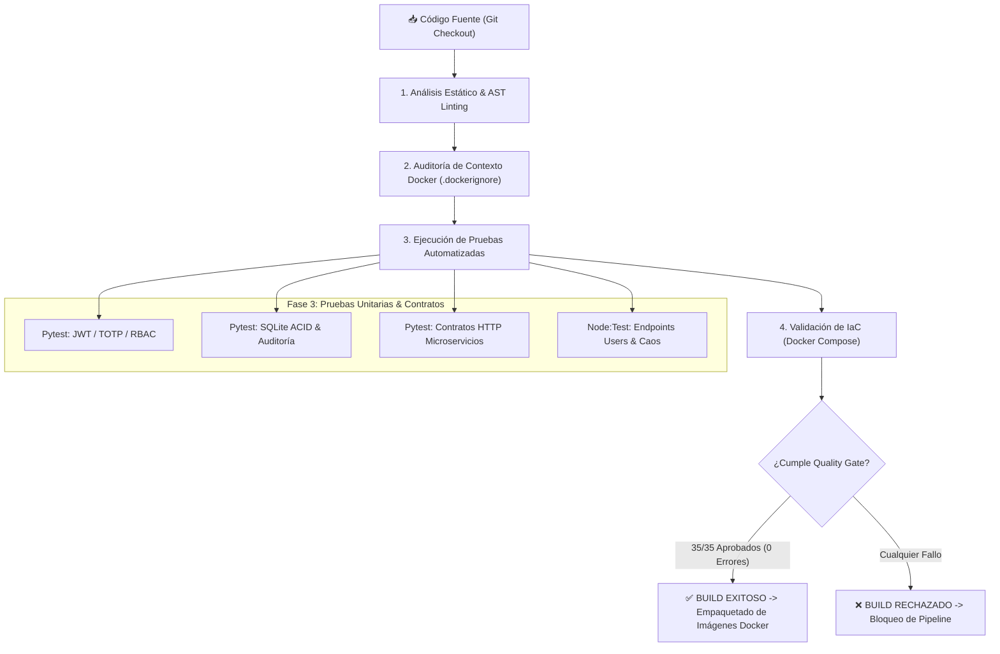

# 🚀 Presentación Académica: Etapa de Build y Quality Gate de DevPilot

Esta presentación está estructurada en **diapositivas técnicas listas para proyectar** o transferir a PowerPoint/Canva, acompañadas del **guion de sustentación verbal** para cada diapositiva.

---

### 📌 Diapositiva 1: Portada y Definición de la Etapa de Build
**DevPilot SRE Platform — Arquitectura de Build y Calidad de Software**

* **Proyecto:** DevPilot — Autonomous Observability, Chaos Testing & AI Remediation Engine
* **Fase del Ciclo de Vida:** Etapa de Build, Empaquetado y Quality Gate
* **Autores:** Sebastián López García & María José Duarte Ospina
* **Revisor:** Ing. Carlos Alfonso Pineda

#### ¿Qué es la Etapa de Build en una Arquitectura de Microservicios?
> En arquitecturas modernas políglotas (Python, Node.js, Docker, JavaScript MVVM), el **Build** no es simplemente compilar un binario; es el **proceso automatizado de verificación de integridad, análisis estático, ejecución de pruebas unitarias/contratos y ensamblado de artefactos contenerizados** antes de permitir el despliegue a producción.

---

### 🏗️ Diapositiva 2: Pipeline de la Etapa de Build (Flujo de CI/CD)
**Estructura del Quality Gate de DevPilot**



> **Principio Fail-Fast (Fallo Temprano):** Si un solo archivo tiene un error de sintaxis, si se rompe la firma criptográfica JWT o si un microservicio viola su contrato HTTP, el build falla inmediatamente en milisegundos, impidiendo el despliegue de software roto.

---

### 🛠️ Diapositiva 3: Herramientas Utilizadas en la Etapa de Build
**Stack Tecnológico de Validación y Construcción**

| Herramienta | Tipo / Propósito | Justificación Técnica |
| :--- | :--- | :--- |
| **Python AST (`compile()`)** | Análisis Sintáctico Estático | Valida la gramática de todo el backend central y microservicios FastAPI en memoria sin latencia de arranque. |
| **Node.js Engine (`node --check`)** | Syntax Linter & Parser V8 | Valida los módulos JavaScript del microservicio Users y la arquitectura frontend MVVM. |
| **Pytest (`pytest`)** | Framework de Pruebas Unitarias | Ejecuta pruebas criptográficas, aislamiento de base de datos en memoria y contratos REST con `TestClient`. |
| **Node:Test & Node:Assert** | Suite Nativa de Pruebas Node.js | Ejecuta pruebas del microservicio Users en tiempo cero sin instalar dependencias pesadas de terceros (Jest/Mocha). |
| **Docker Compose CLI (`config`)** | Validación de IaC | Comprueba la topología de red (`devpilot_net`), puertos, volúmenes y variables de entorno de los 5 contenedores. |
| **Context Stripper (`.dockerignore`)** | Optimización de Build | Aísla los contextos Docker impidiendo que cachés (`__pycache__`, `node_modules`) o secretos (`.env`) inflen las imágenes. |
| **GitHub Actions CI/CD** | Automatización en la Nube | Workflow declarativo YAML en `.github/workflows/build-validation.yml`. |
| **PowerShell & Bash Runners** | Orquestadores de Build Local | Scripts reproducibles `verify-build.ps1` y `verify-build.sh`. |

---

### 🧪 Diapositiva 4: La Suite de 35 Verificaciones del Quality Gate
**Desglose Integral de Pruebas Ejecutadas**

```
Total de Verificaciones: 35 | Aprobadas: 35 | Fallos: 0 (100% Cobertura de Integridad)
```

1. **Análisis Sintáctico y AST (24 pruebas):**
   - 9 servicios backend compilados sin errores (`devpilot_core`, `database`, `auth`, `monitor`, `ai_agent`, `products`, `orders`, `payments`, `users`).
   - 15 módulos del frontend MVVM verificados (`models/`, `controllers/`, `views/`, `js/`).
2. **Auditoría de Aislamiento Docker (6 pruebas):**
   - Verificación estricta de `.dockerignore` en la raíz del clúster y en cada uno de los 5 microservicios.
3. **Pruebas Automatizadas Unitarias y de Contratos (4 bloques):**
   - **Seguridad & RBAC:** Firma y verificación HMAC-SHA256, detección de manipulación de tokens (*tampering*), expiración temporal, códigos 2FA TOTP (RFC 6238) y roles jerárquicos.
   - **Persistencia SQLite ACID:** Esquema relacional, llaves foráneas y bitácora de remediación forense.
   - **Contratos de Microservicios:** Pruebas HTTP simuladas sobre `/health`, `/fault/delay` y catálogos.
   - **Microservicio Users:** 5 pruebas nativas validando ciclo de vida, filtros y middleware de caos.
4. **Infraestructura como Código (1 prueba):**
   - Validación estricta del archivo `docker-compose.yml`.

---

### 💻 Diapositiva 5: ¿Cómo Comprobamos la Etapa de Build? (Demostración)
**Comandos Oficiales de Validación y Reproducibilidad**

#### 1. Validación Automatizada Local (Quality Gate Unificado):
Ejecución en consola Windows (PowerShell) o Linux/macOS (Bash):
```powershell
# En Windows:
.\verify-build.ps1

# En Linux / macOS / WSL:
./verify-build.sh
```

#### 2. Comprobación Individual por Componente:
```bash
# A. Pruebas Unitarias de Backend y Contratos (Pytest)
py -m pytest tests/ -v

# B. Pruebas Unitarias del Microservicio Users (Node.js)
cd microservices/users && npm test

# C. Validación Estática de Contenedores Docker
docker compose config
```

> **Salida esperada:** El script finaliza con código de salida `0` y el mensaje oficial:  
> `ESTADO: [OK] BUILD EXITOSO (El proyecto cumple con el Quality Gate)`.

---

### 🎯 Diapositiva 6: Defectos Corregidos y Conclusiones del Build
**Madurez del Software y Aseguramiento de Calidad**

#### Defectos Detectados y Mitigados durante el Endurecimiento del Build:
* **Bug en Base de Datos (`database.py`):** Se detectó que la tabla `remediation_logs` no se creaba en la inicialización de SQLite. Fue descubierta por la suite de pruebas unitarias y corregida con persistencia ACID.
* **Deprecación de Docker Compose:** Se eliminó la etiqueta obsoleta `version: '3.8'` para alinearse con el estándar moderno de *Compose Specification*.
* **Aislamiento de Contexto:** Se crearon los archivos `.dockerignore` para evitar que los entornos virtuales o dependencias locales inflaran el empaquetado final de producción.

#### Conclusión:
La etapa de build de **DevPilot** garantiza que el software sea **confiable, seguro, reproducible y libre de regresiones**, cumpliendo a cabalidad con los estándares de ingeniería de software definidos en la especificación **IEEE 830**.

---

## 🎙️ Guion de Sustentación Verbal (Lo que debes decir diapositiva por diapositiva)

### Diapositiva 1 (Introducción)
> *"Buenos días profesor y jurado. Hoy les presentamos la etapa de Build de nuestro proyecto DevPilot. En una arquitectura de microservicios moderna y políglota como la nuestra —que combina Python, FastAPI, Node.js y un frontend modular MVVM— el build no se limita a compilar un ejecutable; es el Quality Gate o compuerta de calidad que certifica que todo el código fuente es sintácticamente válido, seguro y que las pruebas automatizadas pasaron al 100% antes de generar las imágenes de Docker."*

### Diapositiva 2 (Pipeline de CI/CD)
> *"Para garantizar que el software sea apto para producción, implementamos un pipeline automatizado bajo el principio de Fail-Fast. Como observan en el diagrama de flujo, el pipeline toma el código fuente y lo pasa por cuatro fases consecutivas: Análisis sintáctico estático, auditoría del contexto de contenedores, pruebas unitarias y validación de infraestructura como código. Si una sola verificación falla, el build se rechaza de inmediato y se bloquea el despliegue."*

### Diapositiva 3 (Herramientas del Build)
> *"Las herramientas que seleccionamos para construir y validar el build fueron cuidadosamente elegidas por su robustez: utilizamos el módulo AST nativo de Python y el parser de Node.js para linting estático en milisegundos; Pytest para la suite de pruebas del backend y de seguridad criptográfica; la suite nativa node:test para evitar sobrecargar el microservicio de usuarios con dependencias externas; y Docker Compose CLI para validar la infraestructura como código. Todo esto se encuentra orquestado tanto localmente mediante scripts en PowerShell y Bash, como en la nube a través de GitHub Actions."*

### Diapositiva 4 (La Suite de 35 Pruebas)
> *"En total, nuestro Quality Gate ejecuta 35 verificaciones automatizadas independientes. Validamos que los 9 componentes backend y los 15 módulos del frontend MVVM compilen sin errores; auditamos que los 5 microservicios tengan reglas de exclusión .dockerignore; y ejecutamos pruebas rigurosas de autenticación JWT HMAC-SHA256, 2FA TOTP bajo estándar RFC 6238, control de acceso basado en roles (RBAC) y contratos HTTP de microservicios."*

### Diapositiva 5 (Cómo lo Comprobamos - Demostración)
> *(En este momento abres la terminal o muestras la captura)*  
> *"La comprobación de la etapa de build es 100% reproducible con un solo comando. Al ejecutar `./verify-build.ps1`, el sistema ejecuta cada uno de los 35 controles en tiempo real. Como pueden observar en la pantalla, las 35 pruebas terminan con estado PASS y cero fallos, certificando que el software cumple con todos los requisitos funcionales y no funcionales."*

### Diapositiva 6 (Conclusiones y Defectos Corregidos)
> *"Un valor fundamental de haber implementado esta etapa de build fue el descubrimiento y resolución temprana de defectos. Por ejemplo, gracias a las pruebas unitarias automatizadas detectamos que la tabla de remediaciones forenses no se estaba inicializando en la base de datos y corregimos configuraciones deprecadas en Docker. En conclusión, DevPilot cuenta con un proceso de build industrial, reproducible y alineado con los estándares internacionales IEEE 830."*
